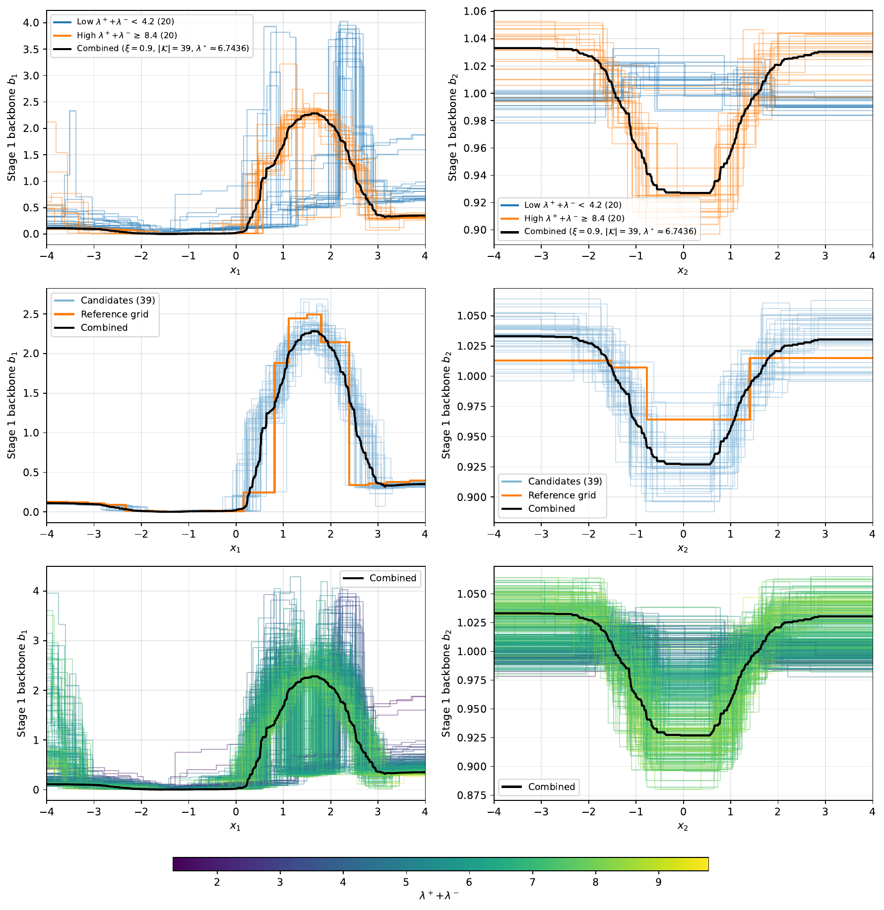

# Bagging & aggregation

A stage is an **aggregate of $n_{\text{grids}}$ bagged grids**, fitted with separate
random seeds and combined into one stage component. At `consensus=0` their fitting
objectives are independent, and each grid fits its own
[bootstrap resample](#bootstrap-resampling) of the rows; positive consensus couples
their training branches.
This page covers the combination math; the code lives in [`StagePredictor`](../code/stage-predictor.md)
(`fit_ensemble`, `aggregate_bagged_two_tensor`, `combine_grids`).

## Why aggregate components, not predictions

An arithmetic mean of products is **not** a product, so averaging the stage predictors
$\hat{m}_{\pm}^{(\ell,c)}$ would break the separable structure. Instead, the per-feature
components $\hat{m}_{\pm,j}^{(\ell,c)}$ are averaged. But factor-wise averaging is fragile:
separable representations are [non-identifiable](model.md#identifiability-and-stability),
so independently fitted factors need not lie in a comparable gauge — two grids can fit the
*same* stage yet sit at opposite ends of the $(\lambda_+,\lambda_-)$ spectrum. The
align → normalize → reference → filter → average pipeline below makes factor shapes
comparable and can reduce disagreement in the retained bag. It does not identify a
unique latent decomposition.

## Bootstrap resampling

In an independent bag ($\rho=0$, $n_{\text{grids}}>1$) with `bootstrap` on, grid $c$
draws $n$ rows uniformly with replacement and counts $k_i^{(c)}$, the number of times row
$i$ is drawn, so $(k_1^{(c)},\dots,k_n^{(c)})$ is multinomial with $n$ trials and equal
probabilities $1/n$. The grid then minimizes the weighted squared error
$\sum_i s_i\,k_i^{(c)}\,(y_i-f(x_i))^2$, with $s_i$ the [sample weight](../code/forest.md#weighted-fits)
($s_i=1$ without one). This is the squared error of the resample with row $i$
repeated $k_i^{(c)}$ times. The counts sum to $n$, so without sample weights the
penalties keep the scale they have on all rows.

Every grid shares the sort orders and histogram bins of the full rows: a row with
$k_i^{(c)}=0$ leaves the grid's loss but still supplies split candidates and counts
toward `min_interval_samples`. The counts come from a stream derived from the grid's
seed, so a fit is deterministic for a given `seed`. With `bootstrap=False` every grid
fits all rows, and the grids differ only in their random split proposals.

## Consensus fitting

Independently fitted grids can reach similar stage functions through different branch
pairs. Agreement on $\hat{m}_+ - \hat{m}_-$ alone does not determine the branches or
their factors ([non-identifiability](model.md#identifiability-and-stability)). At the
function level, adding a common $h$ to both branches preserves their difference;
the rank-1 constraints restrict which such changes are representable. Component
aggregation can therefore produce a function different from the fitted bag members.

With `consensus` $\rho>0$ and at least two grids, the stage is fitted in lockstep.
Each eligible grid takes up to `consensus_interval` local action attempts from its
own randomized candidates: a split, a refit beside an existing boundary (`resplit`),
or a merge. The default interval is 1. Before the round, grid $c$'s local objective
gains a penalty on disagreement with
the other grids' branches. For L2 refinement, its data and consensus terms are

$$
\sum_i \bigl(y_i - \hat{m}^{(c)}(x^{(i)})\bigr)^2
+ \rho \sum_i \Bigl[\bigl(\hat{m}_+^{(c)}(x^{(i)}) - \bar{m}_+^{(-c)}(x^{(i)})\bigr)^2
+ \bigl(\hat{m}_-^{(c)}(x^{(i)}) - \bar{m}_-^{(-c)}(x^{(i)})\bigr)^2\Bigr],
\qquad
\bar{m}_\pm^{(-c)} = \frac{1}{n_{\text{grids}}-1}\sum_{c'\neq c}\hat{m}_\pm^{(c')}.
$$

A multiplicative update $(v_+, v_-)$ on an interval scales both branches on its rows, so
the term stays quadratic in the update: it adds $\rho\,\hat{m}_\pm^2$ to the diagonal
sufficient statistics and $\rho\,(\bar{m}_\pm - \hat{m}_\pm)\,\hat{m}_\pm$ to the linear
ones, with the minus-branch sign accounted for in the solver's coordinates. The
[local parameter penalties and structural costs](fitting.md) also apply. Huber
refinement uses its current IRLS weights for the data term; the consensus term is
unweighted.

References are fixed throughout each round's local batches and refreshed before
the next round. After a global reference refresh, two-branch `Random` fitting can
evaluate only the sampled split positions; the numeric gain and update evaluator is
shared with eager fitting. Initialization, positive-only fitting, and local batch
refreshes use eager scoring. Pending scores are filled before intermediate actions,
so untouched intervals retain the same floating-point cache values. Unused split solves
are avoided when the post-reference action ends its batch with deferred refresh, as in
one-action batches. This internal execution policy has no tuning parameter and is checked by eager/on-demand action
and serialized-model parity tests. A grid whose search finds no improving action ends its batch and is retried
in the next round if another grid progresses. Each grid has at most
$3\,\texttt{n_iter}$ action attempts, with individual attempt numbers in the split log.
Terminated grids, grids that exhaust this attempt budget, and grids at their split
budget with merging disabled receive no further updates, but continue contributing
their branches to the references. The procedure also stops after a whole round without
progress. These synchronous updates do not establish convergence to a common branch
pair, a unique factorization, or descent of one fixed objective across rounds.

The penalty encourages agreement on the observed training rows. On disconnected
covariate support, different factor shapes can have identical branch values on
those rows, so even exact branch agreement need not identify the factors.
Identical large positive and negative branches also incur zero disagreement;
consensus supplies no absolute bound on branch magnitude or cancellation.

The extra curvature can damp updates and reduce diversity among the bags. Both the
change in diversity and any accuracy or runtime benefit require validation.
`consensus=0` retains independent fitting. Full-row consensus refreshes the
reference-dependent statistics each round and refreshes scores according to this
execution policy; with L2 refinement and an unchanged consensus weight, the stored curvature sums are reused. Increasing
`consensus_interval` reduces the frequency of these full refreshes and changes the
fitting schedule. Its speed and validation accuracy must be compared at the same
bag count and structural budget.

### Training-row anchors

With `consensus_anchors=m` and $0<m<n$, a uniform sample $A$ of $m$ training rows
is drawn without replacement and shared by every bag in the stage. The sample is
fixed during that stage. A separate deterministic RNG stream leaves the bag proposal
streams unchanged. `None` and counts at least $n$ use the full-row path.

The data loss continues to use all training observations. Only the agreement penalty
changes to $\rho\frac{n}{m}\sum_{i\in A}[(\hat m_+^{(c)}(x^{(i)})-\bar m_+^{(-c)}(x^{(i)}))^2+(\hat m_-^{(c)}(x^{(i)})-\bar m_-^{(-c)}(x^{(i)}))^2]$.
The factor $n/m$ preserves the expected penalty for fixed branch functions under
uniform sampling. The fitted branches depend on the sample, so this does not imply
an unbiased fitted estimator or equivalent accuracy. Agreement on anchors does not
establish agreement on the remaining rows or identify latent factors.

When every feature uses binned candidate caches and merges are disabled, a reference
change updates only the anchors' $t_1,t_2$ contributions and scatters their deltas into
the bin prefixes. Current curvature and all-row data statistics are retained for
both L2 and Huber refinement. Initialization and other configurations use a full
weighted refresh. Compare complete fitting time, validation accuracy, agreement on
unsampled training rows and the resulting factor curves when selecting an anchor count.

## The aggregation pipeline

Working in the backbone/tilt parametrization, the combination proceeds in steps (Combine
Bagged Two-Tensor Grids):

1. **Align to a common grid.** Refine every bag to the union of all split points per axis
   (`refine_grids_to_union_two_tensor`), so all grids share interval structure.

2. **Normalize (gauge-fix).** For each bag and axis $j$, center $\log b_j$ and $d_j$ by
   subtracting their empirical means over the data:
   $\log b_j \leftarrow \log b_j - \tfrac1n\sum_i \log b_j(x_j^{(i)})$ and
   $d_j \leftarrow d_j - \tfrac1n\sum_i d_j(x_j^{(i)})$. This makes similarities compare
   *shapes* rather than scale or offset. ($\lambda$'s are untouched here.)

3. **Measure factor-shape distance.** Let $\ell_{\pm,j}^{(c),k}$ be the numerically
   bounded log branch factors of the centered grid. For two grids, the distance is

    $$
    D(c,c') = \left[\sum_{j,k} w_j^k\left(
    (\ell_{+,j}^{(c),k}-\ell_{+,j}^{(c'),k})^2+
    (\ell_{-,j}^{(c),k}-\ell_{-,j}^{(c'),k})^2\right)\right]^{1/2},
    $$

   where $w_j^k$ is the training count in the union interval, with a small positive
   weight for empty intervals. The branch scalars do not enter this distance.

4. **Choose a reference.** Select the medoid with the smallest sum of distances:

    $$
    c^\star = \arg\min_c\sum_{c'}D(c,c').
    $$

5. **Trim.** Keep the $K = \lceil(1-\xi)\,n_{\text{grids}}\rceil$ grids nearest to
   $c^\star$, choosing $\xi$ so that $K\ge1$. The default `similarity_threshold=0`
   keeps every grid and skips distance computation. Filtering selects similar
   fitted shapes; it does not establish distinct latent classes or uniqueness.

6. **Average and reconstruct.** Average the surviving factors in log-space and rebuild the
   backbone/tilt. With $a_{\pm,j}^k = b_j^k e^{\pm d_j^k}$,

    $$
    \bar{a}_{\pm,j}^k = \exp\!\Bigl(\tfrac{1}{|\mathcal{K}|}\sum_{c\in\mathcal{K}} \log a_{\pm,j}^{(c),k}\Bigr),
    \qquad
    \bar{b}_j^k = \sqrt{\bar{a}_{+,j}^k\,\bar{a}_{-,j}^k},
    \quad
    \bar{d}_j^k = \tfrac12\log\!\bigl(\bar{a}_{+,j}^k/\bar{a}_{-,j}^k\bigr).
    $$

7. **Normalize the aggregate and combine scalars.** Normalize the reconstructed
   backbone to empirical RMS one and center the tilt on each axis. The returned
   branch scalars are the geometric means of the retained bag scalars:
   $\lambda_{\pm}^{\text{combined}} = \exp\bigl(\tfrac{1}{|\mathcal{K}|}\sum_{c\in\mathcal{K}}\log\lambda_{\pm}^{(c)}\bigr)$.

8. **Coalesce equal bins.** Merge adjacent intervals whose backbone and tilt values
   are bitwise equal, adding their observation counts. Both branch functions are preserved.

After combination the stage coefficients are refit by least squares (the
[backfit](fitting.md#coefficient-backfitting)).

## Aggregation modes in code

The `Aggregation` enum on `StagePredictor` selects how stage predictions use the
fitted bag and its `primary_grid_tensor`:

| Mode | Behavior |
|------|----------|
| `Mean` | arithmetic mean of the unscaled per-grid predictions |
| `GeometricMean` | sign-preserving geometric mean of predictions |
| `Combined` | extract $\tilde{m}_+, \tilde{m}_-$ from the aggregated two-tensor grid and apply the OLS `scaling_plus`/`scaling_minus` |

The component-space pipeline above (align → normalize → similarity-filter → log-space
average) is implemented in `aggregate_bagged_two_tensor`; the chosen `Aggregation` then
determines how the combined grid is turned into stage predictions. See
[StagePredictor](../code/stage-predictor.md) for the exact call path and how
`similarity_threshold` ($\xi$) and the aggregation mode are wired from the Python API.

## The bimodal-alignment example

The illustrated run shows two groups of fitted backbone shapes. Other seeds and
fitting settings can produce overlapping groups or a continuous range of shapes.
The reference and trim steps select a subset of similar representations before
aggregation. The figure does not establish uniqueness or an accuracy benefit for
other datasets. The `synthetic2.py` example provides this type of diagnostic — see
[Examples](../index.md#examples).

<figure markdown="span">
  { width="90%" }
  <figcaption markdown="span">Synthetic example — bagged [GridTensors](../code/grid-tensor.md) at epoch 0 showing two groups of backbone shapes for the same stage. Differences between factor shapes can reflect alternative decompositions or different fitted functions; this plot alone does not distinguish them. Similarity filtering anchors aggregation to a reference representation. Reproduced by the [`synthetic2.py`](../index.md#examples) example script.</figcaption>
</figure>
